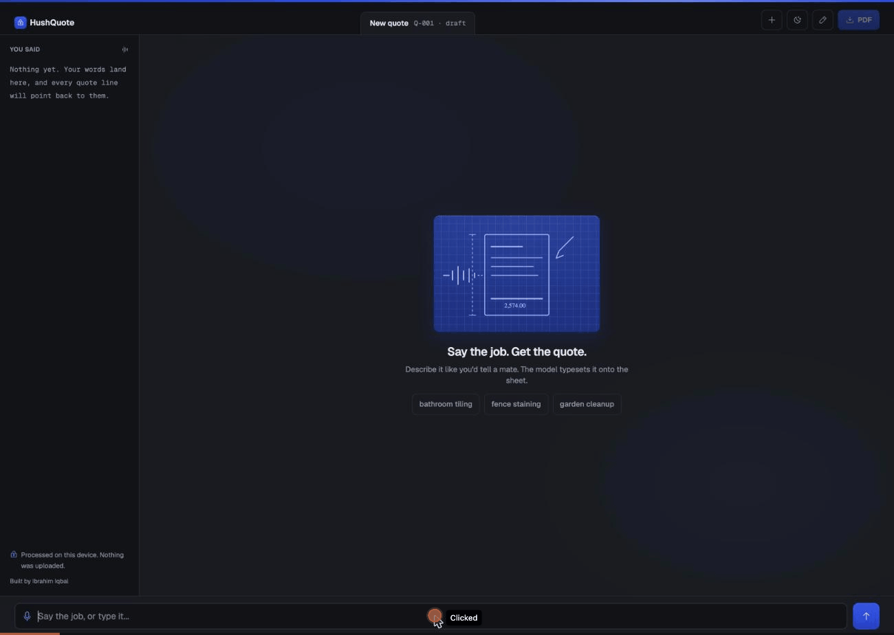
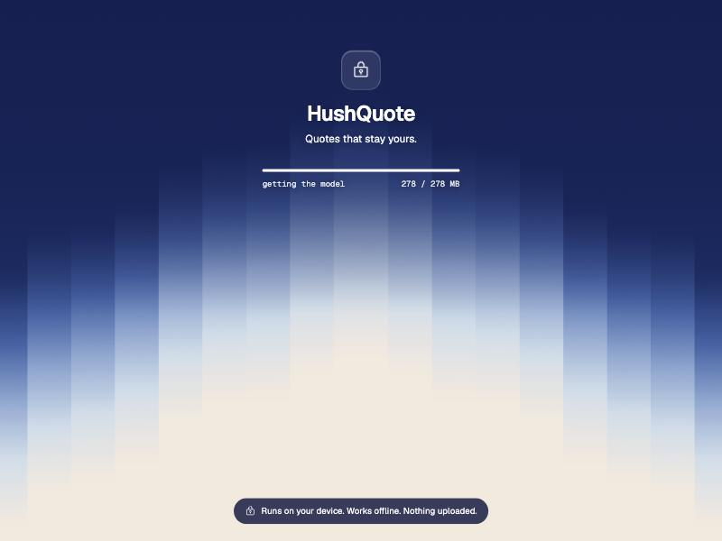
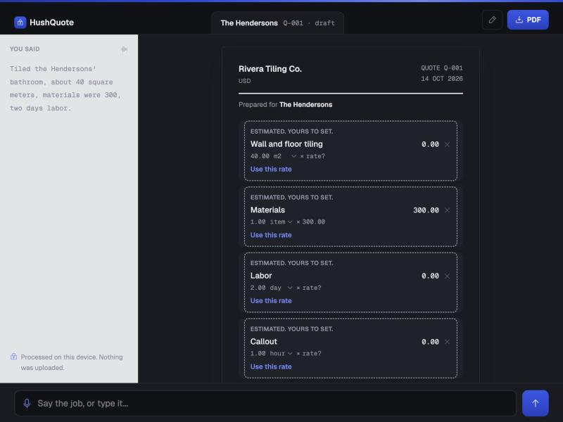
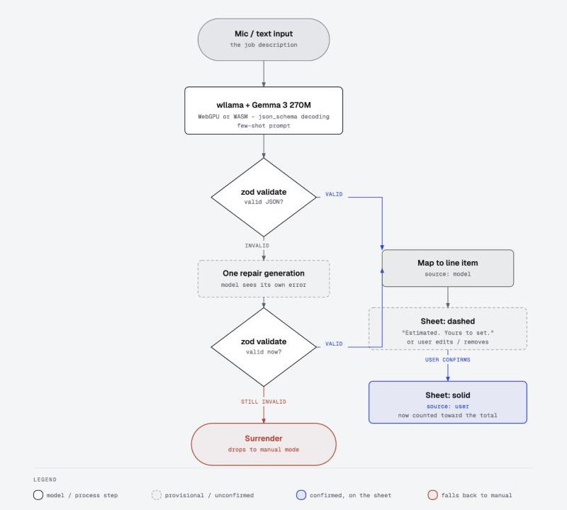

# HushQuote

Speak a job, get a professional quote. A local open-weight model (Gemma 3
270M) runs entirely in your browser via WebAssembly/WebGPU and turns a
spoken or typed job description into an itemized, editable quote, then a
PDF. No account, no server, no backend of any kind. Your clients and rates
never leave the device they were typed on.

**Live:** https://hushquote.onrender.com
**Built for:** [DEV Hacktoberfest Open-Source AI Challenge, Week 2](https://dev.to/events/challenges/hacktoberfest-week2-2026-10-12) ("Side Hustle"), targeting Best Use of Gemma and Best Use of Render.
**Submission post:** https://dev.to/ibrahimiqbal/hushquote-quotes-that-stay-yours-3ldl



## Status

Feature-complete and deployed. Say or type a job, the model extracts
itemized lines (each one visually provisional until confirmed), edit
anything inline, set up a business profile with a logo and a rate library,
and export a PDF via the browser's print dialog. Manual mode (no model
needed) works end to end on its own as a fallback floor.

See `docs/PLAN.md` for the full day-by-day build log and decisions,
`docs/RISKS.md` for the honest extraction-accuracy writeup (a full
20-transcript test sweep, not just a couple of happy-path runs), and
`docs/UI.md` for the design contract.

## Why local AI

Tradespeople and freelancers already pay $10-30/month for invoicing
software that's worse at this one job. HushQuote's model is a file the app
ships, not a service you rent: no API bill, no vendor who can change
pricing under you, and because it runs on-device, a plumber's client list
and day rates never leave their phone. Works offline on a job site with no
signal. The closest competitors in this space (InvoicePilot AI, VaultLedger
AI, and similar Side Hustle submissions) still require a local Ollama or
Python backend process - HushQuote has none at all; it's a static site, and
the model downloads straight into the browser tab.

## Stack

- React 19 + Vite + Tailwind v4
- Zod for all data shapes (`src/lib/schema.js`)
- Phosphor icons, self-hosted Geist / Geist Mono variable fonts
- wllama (in-browser llama.cpp via WebAssembly/WebGPU) running Gemma 3
  270M-instruct (Q8_0), with JSON-schema constrained decoding + zod
  validation + one repair retry before falling back to manual entry
- PDF export via the browser's native print dialog (no added dependency)
- No backend, no database, no accounts, deployed as a static site on Render

## Design

The product is one living document, not a step wizard: a transcript rail
("the Margin") beside an always-visible quote document ("the Sheet"), with a
persistent command bar at the bottom. See `docs/UI.md` for the full design
contract, including the cover page, built from a gradient generated with
[FeralUI](https://feralui.dev/gradients). Motion (line-item stream-in, a
shimmer on AI-estimated lines, a glow while the model's thinking) is scoped
to real state, not decoration - see the D4 UX-pass entries in
`docs/PLAN.md`.





### How extraction works



## Development

```bash
npm install
npm run dev
```

First run downloads the local model (Gemma 3 270M, ~278MB) into
`public/models/` automatically; see `scripts/fetch-model.mjs`. The model
file itself is not committed to the repo.

## License

MIT, see `LICENSE`.
